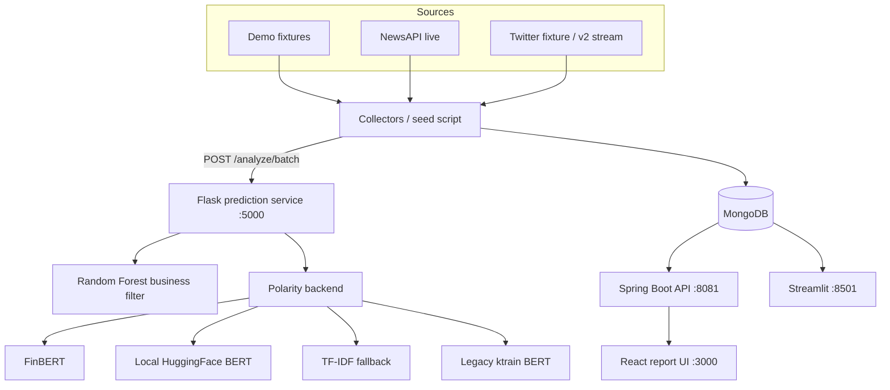

# Architecture

## Components



## Data flow

1. A collector loads a fixture or calls NewsAPI/Twitter.
2. It sends text to `POST /analyze/batch` on the Flask service.
3. The service returns `is_business`, `polarity`, and `polarity_label`.
4. The collector normalizes the record and upserts it into MongoDB.
5. Both UIs read the same collection.

## MongoDB schema

Collection: `StockNewsDB.NewsCollection`

```json
{
  "source_type": "newsapi_fixture",
  "source": {"id": "pfe-fixture", "name": "Reuters"},
  "author": "PFE 2020 dataset",
  "title": "Apple beats earnings expectations",
  "description": "Shares rose after ...",
  "text": "Shares rose after ...",
  "url": "https://example.com/pfe-fixture/1",
  "urlToImage": "/imgs/stock.jpeg",
  "publishedAt": "2026-11-01T10:00:00Z",
  "ticker": "$AAPL",
  "tickers": ["$AAPL"],
  "is_business": 1,
  "prediction": "Positive",
  "polarity": "Positive",
  "polarity_score": 1,
  "polarity_backend": "sklearn",
  "collected_at": "2026-11-03T09:00:00Z"
}
```

Important compatibility details:

- `publishedAt` is an ISO **string**, because the restored Spring aggregations use
  MongoDB `$substr` on it.
- `prediction` is the label string (`Positive`, `Neutral`, `Negative`) because the
  original React UI expects that shape.
- `ticker` includes the `$` prefix (`$AAPL`), matching the original collectors and
  the society details page.
- `polarity_score` is the new `-1/0/1` field for the dashboard.

Other collections:

- `SocietiesInfo` — seeded tickers, names, sectors, industries.
- `users` and `roles` — demo auth for the legacy Spring UI.

## Prediction service contract

| Endpoint | Input | Output |
|---|---|---|
| `GET /health` | — | model/Mongo status |
| `POST /NewsOrNot` | form or JSON `text` | plain `0` or `1` (legacy Java integration) |
| `POST /Polarity` | form or JSON `text` | plain `-1`, `0`, or `1` |
| `POST /analyze` | JSON `{"text": "..."}` | JSON with business/polarity fields |
| `POST /analyze/batch` | JSON `{"items": [{"text": "..."}]}` | JSON `results` list |

## Model resolution

`NewsPredictionMicroservice/models.py` tries the configured polarity backend and
falls back safely:

```text
finbert -> sklearn -> heuristic
hf      -> sklearn -> heuristic
legacy  -> sklearn -> heuristic
sklearn -> heuristic
```

`POLARITY_BACKEND` in `.env` selects the first attempt. This keeps the public
demo working even when the FinBERT download or the legacy TensorFlow environment
is unavailable.

## Database modes

- **Local Docker (default):** `MONGO_URI=mongodb://localhost:27017`
- **Atlas:** put a fresh `mongodb+srv://...` URI in `.env` as `MONGO_URI` for
  host-run Python, or as `MONGO_URI_DOCKER` for Compose.
- **Inside Compose:** services default to `mongodb://mongo:27017`; set
  `MONGO_URI_DOCKER` to use Atlas instead while the local container remains as
  a fallback.
